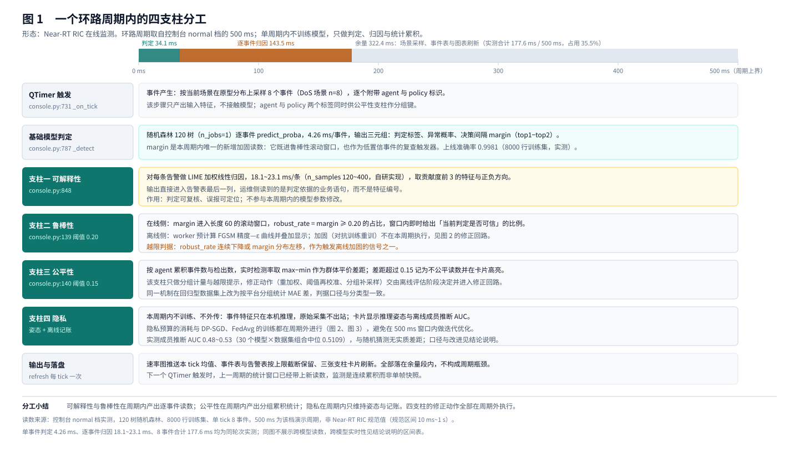
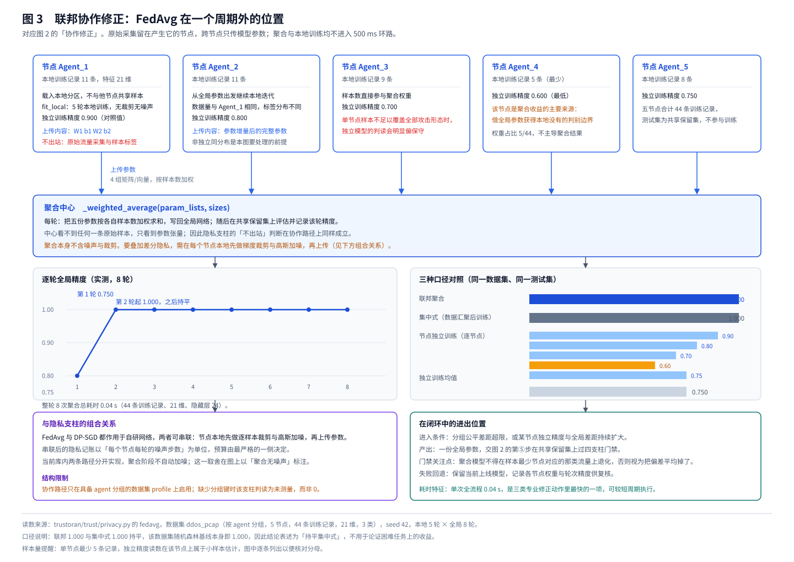
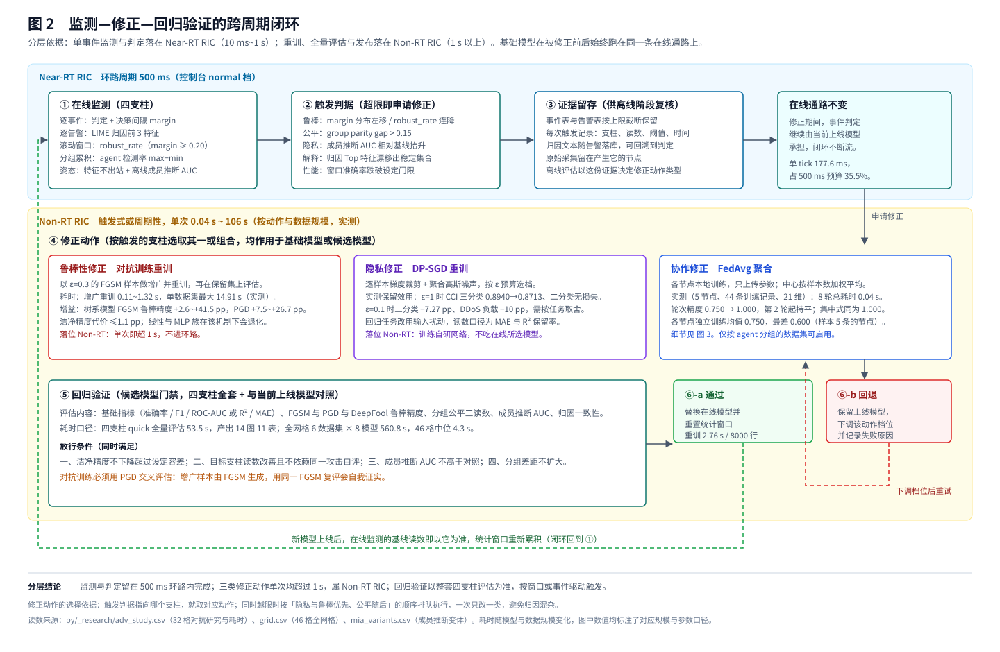

# Trust-ORAN · 面向 Open RAN 的可信 AI 评估工具集

在真实 Open RAN 网络数据上，评估用于控制网络的机器学习模型是否可信——可解释性、鲁棒性、公平性、隐私四个维度

> **English TL;DR** — Trust-oRAN evaluates whether ML models used for Open RAN control can be trusted, across four pillars (explainability, robustness, fairness, privacy) on three real, non-synthetic datasets. It ships as a Python library + CLI, seven executed notebooks, a bilingual PySide6 workbench with a simulated RIC console, and a PDF reporter (3 layouts × 2 languages). Everything runs on CPU with NumPy/pandas/scikit-learn only.

[](https://www.python.org/)
[]()
[]()
[](main/py/MATH_PRINCIPLES.md)

---

## 亮点 / Highlights

全部数字取自仓库内已归档的 CSV 与日志，可逐条核验（见文末「数字来源」）。

| # | 亮点 | 实测 |
|---|---|---|
| 1 | **归因结果与开源库逐位一致** | 与 `shap.TreeExplainer` 逐样本比对：余弦相似度 **1.0000**、最大绝对差 **0**（8/8 情形）；可加性残差 1.4e-14～4.2e-6 |
| 2 | **自研归因引擎更快** | 相对开源采样类实现提速 **2.3×–29.5×**（LIME 式代理 27.7×–29.5×、captum KernelShap 3.1×–27.8×、`shap.KernelExplainer` 2.3×–2.9×）；精确路径 0.016–0.211 ms/样本 |
| 3 | **跑得进 Near-RT 环路** | 8 个事件的判定 + 逐事件归因合计 **177.6 ms**，占 500 ms 环路预算 35.5%（≈18 ms/事件）；加固闭环中位 0.4–2.3 s，落在 Non-RT 秒级窗口 |
| 4 | **对抗加固有效** | 树系模型 PGD 鲁棒精度 **+7.5～26.7 个百分点**，洁净精度代价 **≤1.1 个百分点**；RF 在 `cci_a1sd` 上 0.7000 → 0.8333 |
| 5 | **隐私机制纯 NumPy 自研，不依赖 GPU 与深度学习框架** | DP-SGD（ℓ₂ 裁剪 + 解析高斯噪声）+ FedAvg；分类任务 ε=1 的精度损失多为 **0.00 pp**；FedAvg 5 站点第 2 轮收敛，与集中式**持平**，比各站点独立训练均值 **+25 个百分点** |
| 6 | **负结果也有证据链** | 成员推断 AUC 中位 0.5109、29/30 组合与随机猜测无异；同一攻击器在人为记忆化正对照上读到 0.6357 → 证明「无泄漏」是有效结论而非检测器失效 |

---

## 1. 为什么需要 / Why this exists

Open RAN 把基站软件栈拆开，控制面交给 SMO 与两级 RIC：Non-RT RIC（>1 s）与 Near-RT RIC（10 ms–1 s）。第三方「应用」把自己的模型接进这两级控制器，模型输出会直接改变现网配置。因此上线前必须回答四个问题：**凭什么这么判**（可解释性）、**输入扰动后是否还站得住**（鲁棒性）、**对不同分组是否一视同仁**（公平性）、**模型是否暴露了训练样本**（隐私）。

通用可信 AI 库不覆盖 Open RAN 的数据形态（时序遥测、抓包流特征、回归目标），也缺少运营人员专用的报告出口——本项目补齐这段链路。


*图 1 · 一个环路周期内的四支柱分工：以控制台 normal 档 500 ms 周期为时间轴，可解释性与鲁棒性在周期内产出事件读数，公平性产出分组累积，隐私保持瞬态与隐私预算，四支柱的修正动作全部不在周期内执行。*

---

## 2. 四个评估维度 / The four pillars

| 维度 | 回答的问题 | 本项目的做法 |
|---|---|---|
| 可解释性 | 这次判定依据哪些输入 | 双路由：树模型走库原生 **TreeSHAP 精确解**，其余走自研采样近似；另给置换重要性与 PDP |
| 鲁棒性 | 扰动后判定是否翻转 | FGSM / PGD / DeepFool 三种攻击 + FGSM 对抗训练加固，用 **PGD 交叉评估**（不自己出题自己答） |
| 公平性 | 分组表现是否一致 | 按数据集自带网络侧字段分组，算人口比例差异、等几率差距、离散影响比（80% 规则） |
| 隐私 | 是否泄露个体训练记录 | 自研 **DP-SGD** 与 **FedAvg**（数据不出站点），并用**成员推断攻击**反向验证 |

四个维度由同一条流水线（`main/py/trustoran/pipeline/engine.py`）在同一次训练、同一份划分上依次执行，读数可直接对照。

---

## 3. 数据集 / Datasets

三个数据源**全部来自真实实验台或实测采集，非合成数据**，均取自 IEEE DataPort（授权获取，原始数据不随仓库分发，见第 7 节）。

| 数据集 | 内容 | 任务 | 规模 |
|---|---|---|---|
| **CCI-A1SD** | A1 接口实测流量，标注 Normal / DoS / Covert 隐蔽通道 | 三分类、二分类 | 4 个 CSV 合计约 **342 万行**、30 列；分析取 10 个防御方可观测特征 |
| **DDoS O-RAN PCAP** | 5 个站点的 Near-RT RIC 边缘抓包（良性 HTTP / TCP-SYN 泛洪 / UDP 泛洪） | 三分类 + 联邦演示 | **64 个 `.pcap`**；自带 5 站点分组 |
| **vRAN 遥测** | 虚拟基站实测：能耗、应用时延、算力 | 2 个回归 + 1 个二分类 | energy 20,018×40；application 1,000×39；computing 9 个 CSV |

对外暴露 6 个档位：`cci_a1sd`、`cci_a1sd_binary`、`ddos_pcap`、`vran_energy`、`vran_application`、`vran_computing`（注册表 `main/py/trustoran/data/loaders.py`）。

> 抓包侧值得单独一提：PCAP 解析器（`trustoran/data/pcap.py`）是**纯 NumPy 自研**的，除 NumPy 外不引入任何第三方抓包依赖（不要 scapy / libpcap），逐文件解出约 20 项流级特征。

---

## 4. 实测结果 / Results

### 4.1 基础性能（quick 档，seed 42）

| 档位 | 任务 | Random Forest | XGBoost |
|---|---|---|---|
| `cci_a1sd` | 三分类 | 0.9885 | 0.9902 |
| `cci_a1sd_binary` | 二分类 | 0.9997 / AUC 1.000 | 0.9996 / 0.9998 |
| `vran_energy` | 回归 | R² 0.9889 / MAE 0.409 W | R² 0.9886 / 0.531 W |
| `vran_application` | 回归 | R² 0.9757 / MAE 0.0429 s | R² 0.9762 / 0.0435 s |
| `vran_computing` | 二分类 | 0.9584 / AUC 0.949 | 0.9558 / 0.9498 |

`ddos_pcap` 的 1.0000 属数据集性质（三类场景本身可分），不作为算法优势引用。

### 4.2 可解释性

- **双路由、不静默降级**：XGBoost / LightGBM 在 8/8 情形返回精确解；其余模型在 20/20 情形回退采样，`method="exact"` 但模型无原生接口时直接抛 `ValueError`。
- **正确性可外部核验**：与 `shap.TreeExplainer` 逐样本余弦相似度 1.0000、最大绝对差 0。
- **单条判定出三张判读表**：`reasoning_chain`（观测→触发→归因→依据边界四段）、`hypothesis_check`（13 项候选原因，逐项判支持 / 不支持 / **未测量**，未测量留空不写 0）、`ablation_preview`（按贡献量依次剔除前 1/2/3 项的单样本剔除阶梯）。
- **证据剔除预览**：把勾选列置为背景均值后做一次单样本前向推理，中位 4.13–4.35 ms，且不重训、不新增依赖；已核对「全列置为背景均值」与「直接以背景均值行推理」逐类一致，概率变化与直接重推之差为 0。

### 4.3 鲁棒性

`cci_a1sd`（RF）洁净 0.9933 → FGSM 0.8867 → PGD 0.7000 → DeepFool 0.7500；**对抗训练后回到 0.8333**（ε=0.6）。全扫描（4 档位 × 8 模型）分模型族：

- 树系（RF / HistGB / XGBoost / LightGBM）：PGD 鲁棒精度 **+7.5～26.7 pp**，洁净代价 ≤1.1 pp；
- 线性与神经网络族：当前只做 FGSM 增广，反而退化 2.9～23.8 pp（实现选择后果，PGD 增广在 Roadmap）。

基线已在 0.95 以上的两档读不出改善空间，属真实天花板。**树模型无解析梯度，走有限差分代理，因此鲁棒精度读数整体上是偏高的**

### 4.4 隐私

- **DP-SGD**：逐样本梯度 → ℓ₂ 裁剪 → 依 ε 反解高斯噪声 σ → 加噪更新，纯 NumPy 实现。
- **FedAvg**：5 站点本地训练、只上传参数、按样本数加权聚合，原始数据不出站点。
- 分类侧 ε=1 精度损失：`cci_a1sd_binary` 0.00 pp、`vran_computing` 0.00 pp、`cci_a1sd` −2.27 pp、`ddos_pcap` −10.0 pp（仅 64 条流）。
- 回归侧代价显著更大（R² 0.8810 → 0.0819），因此「差分隐私几乎无代价」**只在分类任务上成立**
- 成员推断：30 个分类组合 AUC 中位 0.5109，最大偏离随机 0.1528，29/30 与猜测无异；记忆化正对照 0.6357 证明检测器本身有效。


*图 3 · FedAvg 联邦结构（ddos_pcap 5 站点）：节点只上传参数、按样本数加权聚合，原始数据不出站点；实测第 2 轮收敛、与集中式持平，右侧给出联邦 / 集中式 / 各站点独立三种口径对照。*

### 4.5 实时性与工程规模

- 全网格 `main/py/_research/grid.py`：46 组合、串行 560.8 s、**0 失败 0 空支柱**，单组合中位 4.4 s。
- 桌面端一次 quick 全量约 53 s，产出 14 幅图、13 张表。
- 代码规模约 **23,500 行**（库与 CLI 4,683、桌面端 10,258、智能体评测 8,607），全部 CPU 运行。


*图 2 · 跨周期闭环：上层 Near-RT（500 ms 环路）只做监测、判据、证据留存与在线守恒不变量；三类修正（鲁棒修正、隐私修正、协作修正 FedAvg）落在 Non-RT（1 s 以上），回归验证以候补模型四支柱全叠 + 与当前上线模型对照，并含 ⑤-a 通过 / ⑤-b 回退两条出口。*

### 4.6 智能体评测扩展 / Agent evaluation

同一套四维方法论平移到大模型智能体（`main/Agent/module_3_agent_eval`，包名 `trustagent`），评测单元从「一次预测」变成「一条轨迹」：想了什么、调了哪个工具、传了什么参数、环境回了什么、是否真改变了系统状态。含 ACL 沙箱（16 个模拟 O-RAN 工具）、五族攻击（指令改写、工具改名、间接提示注入、越权探测、人格一致性）、六维指标，以及「可规则化的判据一律由确定性规则判定、LLM 评判只补语义」的双层判定器（受模型家族分离、多票取中位、Cohen's κ 校准三条护栏约束）。184 用例 mock 全量套件 0.126 s，65 个离线确定性测试通过。

---

## 5. 交付形态 / What is delivered

同一套能力有四种同步形态，共用一个包：

| 形态 | 位置 | 说明 |
|---|---|---|
| 库 + 命令行 | `main/py/trustoran`、`main_cli.py`、`run_all.py` | 单数据集单命令出全套结果；`run_all.py --quick` 一条命令跑遍 6 档位 |
| 研究笔记本 | `ipynb/00`–`ipynb/06` | 7 本（含「自研 vs 开源库」对拍、`ipynb/06` 精确与采样归因对照），已执行并带输出 |
| 桌面工作台 | `main/QtUI`（PySide6） | 中英双语（i18n 1,033 词条）：SMO 概览、四支柱页、模型调参、模拟 Non-RT / Near-RT RIC 事件控制台（带运维门控与审计日志）、智能体评测面板 |
| 报告导出 | `main/QtUI/trustoran_ui/pdf_report.py` | **3 种版式 × 2 种语言** PDF（SMO 运营版 / AI 技术版 / 通俗版），样例见 `main/py/_research/_exact_engine_out/` |

配套：`main/py/MATH_PRINCIPLES.md`（逐算法数学推导 + 35 条自查登记）；`main/py/_research/` 存放产生所有数字的可重跑脚本与 CSV 明细。

---

## 6. 快速开始 / Getting started

**环境**：Python 3.10+；仅依赖 NumPy、pandas、scikit-learn、matplotlib；桌面端另需 PySide6、reportlab。**无 GPU 要求**。XGBoost / LightGBM 装了才进模型工厂；shap / captum / PyTorch 仅用于对比自研算法。

```bash
cd main/py

# 单数据集跑四个维度
python main_cli.py --dataset cci_a1sd --model random_forest --quick

# 只跑指定维度 / 换数据集与模型
python main_cli.py --dataset ddos_pcap --pillars privacy fairness --quick
python main_cli.py --dataset vran_energy --model grad_boost

# 一条命令跑遍 6 个档位
python run_all.py --quick

# 桌面工作台（或双击 main/run.bat）
cd ../QtUI && python main.py

# 智能体评测：离线、确定性、秒级
cd ../Agent/module_3_agent_eval
python -m pytest tests -q && python -m trustagent --quick
```

**项目结构**（`dataset/` 需自行取得授权后放置，见第 7 节）：

```
ipynb/                              7 本已执行笔记本
main/
├── py/trustoran/                   评估库：data / models / trust 四支柱 / viz / pipeline
├── py/main_cli.py, run_all.py      命令行入口与全档位批跑
├── py/MATH_PRINCIPLES.md           数学原理与 35 条自查登记
├── py/_research/                   产生本文所有数字的可重跑脚本与 CSV
├── QtUI/                           PySide6 双语工作台 + PDF 报告
├── Agent/module_3_agent_eval/      智能体评测框架 trustagent（自带 README / tests）
└── run.bat                         Windows 一键启动
```

---

## 7. 数据获取与合规 / Data handling

- 三个数据集经 **IEEE DataPort 授权通道**获取，属有使用条款的第三方数据，**原始文件不随本仓库分发**；本地路径由 `main/py/trustoran/config.py` 的 `CCI_ROOT` / `DDOS_ROOT` / `VRAN_ROOT` 指定。
- 对外发布的所有表格与图均为**聚合量**（指标值、分组样本量、特征贡献值），不含任何原始记录行，也不含模型权重。
- 购买凭证与账号不写入代码、配置或任何报告；智能体模块的推理端点密钥**只在进程内存中传递**，不落盘。
- 引用本项目结论时，请同时保留原始数据集出处（第 9 节 DOI）。

---

## 8. 已知限制 / Known limitations

多数在 `MATH_PRINCIPLES.md` 第八章有编号与证据：

1. **DP 噪声尺度存在待修缺陷**：加噪发生在梯度求和之后又除以批次长度，实际噪声低于声明值约 64 倍（`trust/privacy.py:107-112`）；
2. 树模型无解析梯度，对抗攻击走有限差分代理，鲁棒精度读数偏高；
3. DP-SGD 与 FedAvg 训练自研小型网络，不评估所选大模型；
4. 成员推断只对分类任务执行；FedAvg 只在 `ddos_pcap`（有站点分组）可跑；
5. 智能体评测默认 mock 模式检验的是**评测脚手架本身**，接真实端点后才产生可对外引用的结论；
6. 公平性分组字段是网络侧属性（策略类型 / 站点 / 硬件平台），三个数据集不含受保护人群属性，不能替代真实人群公平性评测；
7. 归因存在两处口径差异需同屏说明：精确路径解释 margin，采样路径解释概率；

---

## 9. 数据来源与引用 / References

**数据集**（DOI 解析形如 `https://doi.org/10.21227/64s5-q431`）

1. Salvat Lozano et al., "O-RAN experimental evaluation datasets", IEEE DataPort 2022, doi:10.21227/64s5-q431 → `vran_*` 三档位
2. Malmalabaduge et al., "CCI-A1SD: An Empirical O-RAN A1 Interface Security Dataset", IEEE DataPort, doi:10.21227/7pbp-4367 → `cci_a1sd*`
3. Alalyan et al., "A low-latency, short-horizon dataset for rapid cyberattack detection in 5G O-RAN environments", IEEE DataPort, doi:10.21227/vktw-y987 → `ddos_pcap`

**方法**：SHAP / TreeSHAP（Lundberg & Lee, NeurIPS 2017；Nature MI 2019）· LIME（Ribeiro et al., KDD 2016）· FGSM（Goodfellow et al., ICLR 2015）· PGD 与对抗训练（Madry et al., ICLR 2018）· DeepFool（Moosavi-Dezfooli et al., CVPR 2016）· DP-SGD（Abadi et al., CCS 2016）· FedAvg（McMahan et al., AISTATS 2017）· 成员推断（Shokri et al., IEEE S&P 2017；ML-Leaks, NDSS 2019；LiRA, AISTATS 2022）· 等几率差距（Hardt et al., NeurIPS 2016）· O-RAN ALLIANCE WG1/WG3 公开规范（表述均为转述）。

**数字来源 / Where the numbers come from**

| 引用位置 | 可核验文件 |
|---|---|
| 鲁棒性全扫描与对抗训练增益 | `main/py/_research/adv_study.csv` |
| 归因路由、与 TreeExplainer 一致性、每样本耗时 | `main/py/_research/exact_shap_check.csv`、`exact_engine_run.log` |
| 46 组合网格、DP 与模型解耦验证 | `main/py/_research/grid.csv` |
| 成员推断族读数与记忆化正对照 | `main/py/_research/mia_variants.csv`、`mia_library_check.log` |
| 数学推导与 35 条自查登记 | `main/py/MATH_PRINCIPLES.md`（第八章） |

---

## Roadmap

- [ ] 修复 DP 噪声尺度缺陷
- [ ] PGD 增广对抗训练，补齐线性 / 神经网络族的鲁棒性退化
- [ ] 完成 `QtUI/` 与 `trustagent/` 的全量走读审计

---

*本仓库为个人研究作品集，评估方法与实现均为独立工作；数据集引用见第 9 节，规范表述为公开资料转述，不涉及任何组织内部数据或业务信息。*
